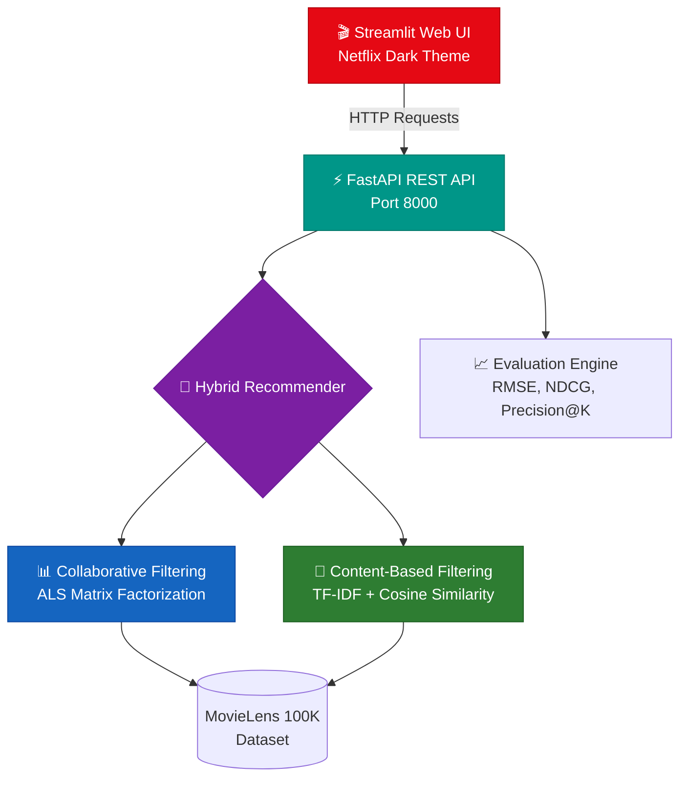

# 🎬 Movie Recommendation System

[](https://python.org)
[](LICENSE)
[](https://github.com/jaibhortake/ML-model-for-movie-recommendation-system/actions)
[](https://fastapi.tiangolo.com)
[](https://streamlit.io)

A **production-grade, Netflix-style hybrid movie recommendation system** built with collaborative filtering (ALS matrix factorization), content-based filtering (TF-IDF + cosine similarity), and a hybrid ensemble that dynamically blends both approaches. Features a FastAPI REST API, a Netflix-themed Streamlit web UI, Docker deployment, and CI/CD pipeline.

---

## 🏗️ Architecture



## ✨ Features

| Category | Features |
|----------|----------|
| 🧠 **ML Models** | ALS Matrix Factorization, Neural Collaborative Filtering, TF-IDF Content-Based, Hybrid Ensemble |
| 🌐 **REST API** | FastAPI with OpenAPI docs, pagination, search, CORS, health checks |
| 🎨 **Web UI** | Netflix-style dark theme, movie cards, star ratings, genre tags, performance dashboard |
| 📊 **Evaluation** | RMSE, MAE, Precision@K, Recall@K, NDCG@K, Coverage, Diversity |
| 🐳 **DevOps** | Dockerfile, docker-compose, GitHub Actions CI/CD, Makefile |
| 🧪 **Testing** | pytest suite with fixtures, API tests, model tests, 80%+ coverage target |
| ⚙️ **Config** | Pydantic Settings with env vars, modular architecture |

---

## 🚀 Quick Start

### 1. Clone & Install

```bash
git clone https://github.com/jaibhortake/ML-model-for-movie-recommendation-system.git
cd ML-model-for-movie-recommendation-system

# Create virtual environment
python -m venv venv
source venv/bin/activate  # Windows: venv\Scripts\activate

# Install dependencies
pip install -r requirements.txt
```

### 2. Train the Model

```bash
python scripts/train.py --model_type hybrid --epochs 20 --n_factors 50
```

This will:
- Download MovieLens 100K dataset automatically
- Train collaborative + content-based models
- Evaluate on holdout test set
- Save model artifacts to `models/`

### 3. Run the System

**Start API server:**
```bash
uvicorn src.api.main:app --host 0.0.0.0 --port 8000 --reload
```

**Start Web UI** (in a new terminal):
```bash
streamlit run src/web/app.py
```

**Or use Docker:**
```bash
docker-compose up --build
```

| Service | URL |
|---------|-----|
| 🌐 Web UI | http://localhost:8501 |
| ⚡ API Docs | http://localhost:8000/docs |
| ❤️ Health Check | http://localhost:8000/ |

---

## 📡 API Endpoints

| Method | Endpoint | Description |
|--------|----------|-------------|
| `GET` | `/` | Health check & system status |
| `GET` | `/api/v1/movies` | List movies (paginated, searchable) |
| `GET` | `/api/v1/movies/{id}` | Get movie details |
| `GET` | `/api/v1/recommendations/{user_id}` | Personalized recommendations |
| `GET` | `/api/v1/similar/{movie_id}` | Find similar movies |
| `POST` | `/api/v1/ratings` | Submit a user rating |
| `GET` | `/api/v1/metrics` | Model performance metrics |

**Example:**
```bash
# Get top 10 recommendations for user 42
curl http://localhost:8000/api/v1/recommendations/42?n=10&method=hybrid

# Search movies
curl http://localhost:8000/api/v1/movies?search=star+wars&page=1&per_page=10
```

---

## 📁 Project Structure

```
ML-model-for-movie-recommendation-system/
├── .github/
│   └── workflows/
│       └── ci.yml                 # GitHub Actions CI/CD
├── config/
│   ├── __init__.py
│   └── settings.py                # Pydantic Settings configuration
├── scripts/
│   ├── train.py                   # Model training CLI
│   └── evaluate.py                # Evaluation & reporting
├── src/
│   ├── __init__.py
│   ├── api/
│   │   ├── __init__.py
│   │   ├── main.py                # FastAPI application
│   │   └── schemas.py             # Pydantic request/response models
│   ├── data/
│   │   ├── __init__.py
│   │   ├── loader.py              # MovieLens data downloader & parser
│   │   ├── dataset.py             # Dataset utilities
│   │   └── preprocessor.py        # Feature engineering & splits
│   ├── models/
│   │   ├── __init__.py
│   │   ├── collaborative.py       # ALS & Neural CF models
│   │   ├── content_based.py       # TF-IDF content recommender
│   │   ├── hybrid.py              # Netflix-style hybrid ensemble
│   │   ├── recommender.py         # Core recommender engine
│   │   └── evaluation.py          # Metrics (RMSE, NDCG, P@K, etc.)
│   └── web/
│       ├── __init__.py
│       └── app.py                 # Streamlit Netflix-style UI
├── tests/
│   ├── __init__.py
│   ├── conftest.py                # Shared pytest fixtures
│   ├── test_api.py                # API endpoint tests
│   ├── test_data_loader.py        # Data loading tests
│   ├── test_evaluation.py         # Metrics tests
│   ├── test_models.py             # Model tests
│   └── test_preprocessor.py       # Preprocessing tests
├── models/                        # Trained model artifacts (gitignored)
├── data/                          # Downloaded datasets (gitignored)
├── reports/                       # Generated evaluation reports
├── Dockerfile                     # Multi-stage Docker build
├── docker-compose.yml             # API + Web UI orchestration
├── Makefile                       # Development shortcuts
├── pyproject.toml                 # Project metadata & tool config
├── requirements.txt               # Production dependencies
├── requirements-dev.txt           # Development dependencies
├── LICENSE                        # MIT License
└── README.md                      # This file
```

---

## 🧠 Model Details

### Collaborative Filtering — ALS Matrix Factorization

Decomposes the user-item ratings matrix $R \in \mathbb{R}^{m \times n}$ into two low-rank factor matrices:

$$R \approx W H^T$$

where $W \in \mathbb{R}^{m \times k}$ (user factors) and $H \in \mathbb{R}^{n \times k}$ (item factors). Optimized via Alternating Least Squares with L2 regularization:

$$\min_{W,H} \sum_{(i,j) \in \Omega} (R_{ij} - w_i^T h_j)^2 + \lambda(\|W\|_F^2 + \|H\|_F^2)$$

### Content-Based Filtering — TF-IDF + Cosine Similarity

Builds item feature vectors from movie titles (TF-IDF n-grams) and genres (multi-hot encoding). Recommends movies with highest cosine similarity to a user's preference profile:

$$\text{sim}(a, b) = \frac{v_a \cdot v_b}{\|v_a\| \|v_b\|}$$

### Hybrid Ensemble (Netflix-Style)

Dynamically blends collaborative and content-based scores with adaptive weighting:

$$\text{score}(u, i) = \alpha \cdot \text{CF}(u, i) + (1 - \alpha) \cdot \text{CB}(u, i)$$

- **Active users** (≥5 ratings): $\alpha = 0.7$ (collaborative-heavy)
- **Cold-start users** (<5 ratings): $\alpha = 0.3$ (content-heavy)

### Evaluation Metrics

| Metric | Description |
|--------|-------------|
| **RMSE** | Root Mean Square Error on rating predictions |
| **MAE** | Mean Absolute Error on rating predictions |
| **Precision@K** | Fraction of top-K recommendations that are relevant |
| **Recall@K** | Fraction of relevant items found in top-K |
| **NDCG@K** | Normalized Discounted Cumulative Gain (ranking quality) |
| **Coverage** | Fraction of catalog items recommended across all users |

---

## ⚙️ Configuration

Configure via environment variables (prefix `RECSYS_`):

| Variable | Default | Description |
|----------|---------|-------------|
| `RECSYS_MODEL_DIR` | `models` | Directory for model artifacts |
| `RECSYS_DATA_DIR` | `data` | Directory for datasets |
| `RECSYS_API_HOST` | `0.0.0.0` | API server host |
| `RECSYS_API_PORT` | `8000` | API server port |
| `RECSYS_LOG_LEVEL` | `INFO` | Logging level |
| `RECSYS_MODEL_TYPE` | `hybrid` | Model type (hybrid/collaborative/content) |
| `RECSYS_N_FACTORS` | `50` | Number of latent factors |
| `RECSYS_N_RECOMMENDATIONS` | `10` | Default number of recommendations |
| `RECSYS_COLLABORATIVE_WEIGHT` | `0.7` | Collaborative filtering weight in hybrid |
| `RECSYS_CONTENT_WEIGHT` | `0.3` | Content-based weight in hybrid |

---

## 🐳 Docker

```bash
# Build and run
docker-compose up --build

# Build only
docker build -t movie-rec-system .

# Run API only
docker run -p 8000:8000 movie-rec-system
```

---

## 🧪 Development

```bash
# Install dev dependencies
pip install -r requirements-dev.txt

# Run tests
pytest tests/ -v --cov=src --cov-report=html

# Lint
ruff check src/ tests/
ruff format --check src/ tests/

# Type check
mypy src/

# Format code
black src/ tests/
```

---

## 🤝 Contributing

1. Fork the repository
2. Create a feature branch (`git checkout -b feature/amazing-feature`)
3. Commit your changes (`git commit -m 'Add amazing feature'`)
4. Push to the branch (`git push origin feature/amazing-feature`)
5. Open a Pull Request

---

## 📄 License

This project is licensed under the MIT License — see the [LICENSE](LICENSE) file for details.

---

<p align="center">
  Built with ❤️ by <a href="https://github.com/jaibhortake">Jai Bhortake</a>
</p>
