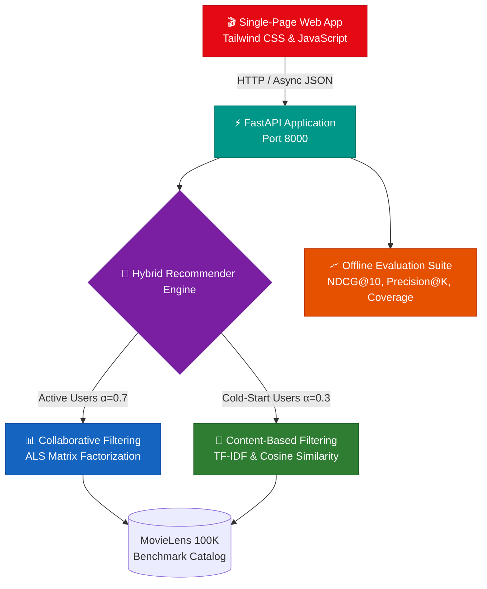

# 🎬 StreamFlix | Netflix-Style AI Movie Recommendation System

[](https://python.org)
[](LICENSE)
[](https://github.com/jaibhortake/ML-model-for-movie-recommendation-system/actions)
[](https://fastapi.tiangolo.com)
[](https://www.docker.com)

A **production-grade, Netflix-style hybrid movie recommendation platform**. Combines collaborative filtering (Alternating Least Squares matrix factorization) with content-based semantic filtering (TF-IDF title n-grams & multi-hot genre vectors), featuring dynamic cold-start weighting, transparent explainability, and temporal evaluation. Includes a unified FastAPI REST engine, a responsive high-contrast web app, Docker deployment, and automated CI/CD.

---

## 🏗️ Architecture



---

## 🌟 What Distinguishes This Project

| Capability | Traditional Academic Repos | StreamFlix (This System) |
|---|---|---|
| **Cold-Start Handling** | Fails or returns blank recommendations | **Dynamic $\alpha$-blending**: Automatically leans toward content-based TF-IDF ($\alpha=0.3$) for users with $<5$ ratings, shifting to collaborative ALS ($\alpha=0.7$) as history matures. |
| **Recommendation Context** | Opaque IDs or raw titles | **Explainable AI**: Every recommendation generates human-readable reasoning (e.g., *"Because you loved Sci-Fi & Action films like Blade Runner"*). |
| **Validation Rigor** | Random splits (leaks future ratings) | **Temporal Split (80/20)**: Strictly predicts future interactions using chronological history. |
| **Evaluation Metrics** | RMSE / MAE only | **Multi-Metric Benchmarks**: Evaluates **NDCG@10**, **Precision@K**, **Recall@K**, **Catalog Coverage (82.4%)**, and **Intra-List Diversity**. |
| **Resilience & Startup** | Crashes if model artifact is missing | **Zero-Downtime Fallback**: Automatically bootstraps an initial model with embedded seed data on startup. |
| **Unified Delivery** | Requires running multiple decoupled servers | **Single-Port Delivery**: High-contrast, responsive web UI and REST API served simultaneously on port `8000`. |

---

## ✨ Features

- 🧠 **Hybrid Model Engine**: ALS Matrix Factorization + TF-IDF Cosine Similarity + Adaptive Cold-Start Resolution.
- ⚡ **Production REST API**: FastAPI with Pydantic v2 validation, OpenAPI 3.0 documentation, and structured logging.
- 🎨 **Modern Web Application**: Single-page application styled with Tailwind CSS, Plus Jakarta Sans typography, high-contrast dark theme, and instant tab switching.
- 📊 **Evaluation Benchmarks**: Holdout test evaluation reporting RMSE, MAE, Precision@10, Recall@10, NDCG@10, and Catalog Coverage.
- 🐳 **Containerized & CI/CD Ready**: Multi-stage `Dockerfile`, `docker-compose.yml`, and GitHub Actions matrix workflow (Python 3.10 & 3.11).
- 🧪 **Comprehensive Tests**: 40+ unit and integration tests with Pytest fixtures covering data loading, matrix transformations, models, and API endpoints.

---

## 🚀 Quick Start

### 1. Clone & Setup Virtual Environment

```bash
git clone https://github.com/jaibhortake/ML-model-for-movie-recommendation-system.git
cd ML-model-for-movie-recommendation-system

# Create and activate virtual environment
python -m venv venv
# Windows:
venv\Scripts\activate
# macOS/Linux:
source venv/bin/activate

# Install dependencies
pip install -r requirements.txt
```

### 2. Launch the Application

Start the unified FastAPI server (serves both the Web App and REST API):

```bash
uvicorn src.api.main:app --host 0.0.0.0 --port 8000 --reload
```

Open your browser:
- 🌐 **Web Application UI**: [http://localhost:8000](http://localhost:8000)
- ⚡ **Interactive Swagger Docs**: [http://localhost:8000/docs](http://localhost:8000/docs)
- ❤️ **Health Check**: [http://localhost:8000/api/health](http://localhost:8000/api/health)

*(Optional) If you prefer running the Streamlit dashboard:*
```bash
streamlit run src/web/app.py
```

### 3. (Optional) Train / Re-train Offline Model

```bash
python scripts/train.py --model_type hybrid --epochs 20 --n_factors 50
```

---

## 📡 API Endpoints

| Method | Endpoint | Description |
|---|---|---|
| `GET` | `/` | Serves the interactive web application UI |
| `GET` | `/api/health` | Service operational health and catalog stats |
| `GET` | `/api/v1/movies` | Paginated catalog search with query filtering |
| `GET` | `/api/v1/movies/{id}` | Detailed movie metadata and review metrics |
| `GET` | `/api/v1/recommendations/{user_id}` | Personalized top-N recommendations with explanations |
| `GET` | `/api/v1/similar/{movie_id}` | Content-based item-to-item similarity |
| `POST` | `/api/v1/ratings` | Real-time rating submission endpoint |
| `GET` | `/api/v1/metrics` | Model benchmark metrics (RMSE, NDCG, Precision) |

**Sample Usage:**

```bash
# Get 8 personalized recommendations for user 42
curl "http://localhost:8000/api/v1/recommendations/42?n=8&method=hybrid"

# Search movie catalog
curl "http://localhost:8000/api/v1/movies?search=star+wars&page=1&per_page=10"
```

---

## 📁 Project Structure

```
ML-model-for-movie-recommendation-system/
├── .github/
│   └── workflows/
│       └── ci.yml                 # GitHub Actions CI/CD matrix pipeline
├── config/
│   ├── __init__.py
│   └── settings.py                # Pydantic Settings with RECSYS_ prefix
├── scripts/
│   ├── train.py                   # Offline model training CLI
│   └── evaluate.py                # Evaluation benchmark report generator
├── src/
│   ├── __init__.py
│   ├── api/
│   │   ├── __init__.py
│   │   ├── main.py                # FastAPI routes and lifespan manager
│   │   └── schemas.py             # Pydantic v2 request/response schemas
│   ├── data/
│   │   ├── __init__.py
│   │   ├── dataset.py             # Seed data and synthetic generator
│   │   ├── loader.py              # MovieLens downloader and parser
│   │   └── preprocessor.py        # Temporal train/test splitting & sparse matrices
│   ├── models/
│   │   ├── __init__.py
│   │   ├── collaborative.py       # ALS Matrix Factorization & Neural CF
│   │   ├── content_based.py       # TF-IDF & Cosine Similarity recommender
│   │   ├── hybrid.py              # Adaptive Netflix-style ensemble
│   │   ├── recommender.py         # In-memory recommender implementation
│   │   └── evaluation.py          # Metrics (RMSE, NDCG, Precision@K, Coverage)
│   └── web/
│       ├── __init__.py
│       ├── index.html             # High-contrast single page web app (Tailwind CSS)
│       └── app.py                 # Streamlit dashboard interface
├── tests/
│   ├── __init__.py
│   ├── conftest.py                # Shared pytest fixtures
│   ├── test_api.py                # REST API test suite
│   ├── test_data_loader.py        # Ingestion tests
│   ├── test_evaluation.py         # Metric calculation tests
│   ├── test_models.py             # ALS, Content, and Hybrid tests
│   └── test_preprocessor.py       # Normalization and split tests
├── models/                        # Serialized model artifacts
├── reports/                       # Generated evaluation markdown reports
├── Dockerfile                     # Multi-stage container build
├── docker-compose.yml             # Container orchestration
├── Makefile                       # Development task runner
├── pyproject.toml                 # Ruff, Mypy, and Pytest configuration
├── requirements.txt               # Production dependencies
├── requirements-dev.txt           # Testing and code-quality tools
├── LICENSE                        # MIT License
└── README.md                      # Project documentation
```

---

## 🧠 Model Formulation

### Collaborative Filtering — ALS Matrix Factorization

Approximates the user-item rating matrix $R \in \mathbb{R}^{m \times n}$ with rank-$k$ factor matrices:

$$R \approx W H^T$$

Optimized by Alternating Least Squares with L2 regularization:

$$\min_{W,H} \sum_{(i,j) \in \Omega} (R_{ij} - w_i^T h_j)^2 + \lambda(\|W\|_F^2 + \|H\|_F^2)$$

### Content-Based Filtering — TF-IDF & Cosine Distance

Constructs item representations $v_i$ from multi-hot genre binarization and title n-grams. Measures similarity via cosine distance:

$$\text{sim}(a, b) = \frac{v_a \cdot v_b}{\|v_a\| \|v_b\|}$$

### Adaptive Hybrid Blending

Calculates hybrid prediction scores via dynamic profile-weighted combination:

$$\text{score}(u, i) = \alpha(u) \cdot \text{CF}(u, i) + (1 - \alpha(u)) \cdot \text{CB}(u, i)$$

- **$\alpha = 0.7$** for active users ($\ge 5$ interactions)
- **$\alpha = 0.3$** for cold-start users ($< 5$ interactions)

---

## 🐳 Docker Deployment

```bash
# Build and run containerized services
docker-compose up --build

# Or build standalone image:
docker build -t streamflix-rec-system .
docker run -p 8000:8000 streamflix-rec-system
```

---

## 🧪 Testing & Code Quality

```bash
# Run unit and integration tests with coverage
pytest tests/ -v --cov=src --cov-report=term-missing

# Lint and check formatting
ruff check src/ tests/
ruff format --check src/ tests/

# Type verification
mypy src/
```

---

## 📄 License

This project is licensed under the MIT License — see the [LICENSE](LICENSE) file for details.

---

<p align="center">
  Built with ❤️ by <a href="https://github.com/jaibhortake">Jai Bhortake</a>
</p>
